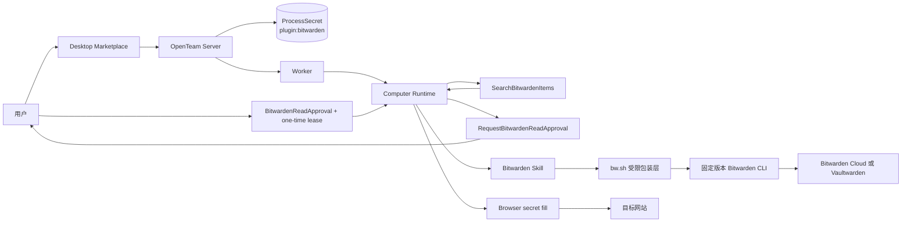

# 设计文档 - Bitwarden 与 Vaultwarden 凭据插件接入

状态：实施中（2026-11-13 复核修订）

父规格：[Spec 005：插件扩展体系](../005-插件扩展体系/design.md)

## 1. 概述

### 1.1 目标

- 复用当前 1Password 的 Skills 运行模型，为 Bot 和 `computerUse` 提供 Bitwarden/Vaultwarden 登录项读取能力。
- 通过固定版本、完整性校验和受限包装脚本使用 Bitwarden CLI，避免将任意 Vault 写操作暴露给 Skill。
- 支持自托管 Vaultwarden server URL、API Key 登录、主密码解锁、同步和 Login item 读取。
- 通过插件运行时字段扩展，让 server URL、email 等普通配置能够安全到达 Skill 进程。
- 保持现有插件生命周期、process secret、Skill 缓存、Shell 脱敏和浏览器 secret fill 行为。

### 1.2 覆盖需求

- `requirements.md` 需求 1、2：插件目录、安装和配置字段。
- `requirements.md` 需求 3：普通 runtime field 与 secret runtime field 的传递。
- `requirements.md` 需求 4、9：CLI 生命周期和 Vaultwarden 自托管兼容。
- `requirements.md` 需求 5、6、7：凭据读取、浏览器登录和安全边界。
- `requirements.md` 需求 8、10：错误分类、测试和发布验收。

### 1.3 技术约束

- 插件包：`packages/plugins/bitwarden/`。
- 插件类型：Skills-only；`components: ["skills"]`，`connections: []`。
- 运行位置：Bot computer 的 Shell 进程；不在 OpenTeam server 进程中直接访问 Vaultwarden。
- 凭据存储：复用 `ProcessSecret` 和插件 owner key `plugin:bitwarden`。
- Skill 传递：复用 `plugin-skills/cache.json` 和 `pluginSkillAgent`。
- Shell 执行：复用 `ReadProcessSecrets`、`nativeToolExecutor.shell`、`SecretRedactor`。
- 浏览器填充：复用现有 browser reference driver 的 secret fill 标记和结果脱敏。
- 外部依赖：固定版本的 Bitwarden CLI、Bitwarden/Vaultwarden server、Bot computer 的网络和证书信任链。
- 发布约束：插件生成器必须将文本和二进制资源打入 registry，安装时不得依赖未声明的 node_modules。

## 2. 架构

### 2.1 系统结构



关键数据流：

1. 用户在 Marketplace 配置插件字段。
2. Server 将字段值写入现有插件级 process secret 存储，并只向设置视图返回配置状态。
3. Worker 将 Skill 元数据和支持文件同步到 Bot computer，并把适用的 Skill 提供给 `main` 和 `computerUse`。
4. Bot 使用 `SearchBitwardenItems` 获取非 secret metadata；首次读取某个 item 时调用 `RequestBitwardenReadApproval`，Server 发送 widget 并持久化授权状态。
5. 用户选择或批准后，Computer 私有路径消费短时 lease，将 protected runtime fields 只注入 wrapper 子进程，向 Bitwarden/Vaultwarden 发起登录、解锁、同步和读取请求。
6. 读取结果返回当前 Bot，用于当前任务或浏览器安全填充；普通 Shell、MCP process 和子机器人不能读取 protected fields。

### 2.2 模块职责

| 模块 | 职责 | 输入 | 输出 |
| --- | --- | --- | --- |
| `packages/plugins/bitwarden/plugin.json` | 声明插件元数据、runtime fields 和 Skill | 插件定义 | 可校验的 `PluginDefinition` |
| `packages/plugins/bitwarden/skills/bitwarden/SKILL.md` | 告诉 Bot 何时搜索、请求授权和读取 Login item | 用户任务、Skill 路径 | first-party 工具调用计划 |
| `ensure-cli.sh` | 安装、校验和定位固定 CLI | 平台、版本、下载地址 | CLI 可执行文件路径 |
| `bw.sh` | 执行 server 配置、登录、解锁、同步和读取白名单动作 | runtime fields、动作参数 | 安全的字段级结果或错误摘要 |
| `packages/plugin-sdk` | 校验 runtime field，允许非 secret environment field | 插件定义 | 合法字段模型 |
| `apps/server` 插件安装服务 | 保存、替换、清理插件运行字段 | setup values | `ProcessSecret` 更新和插件状态 |
| `apps/computer` runtime | 隔离 protected fields、消费 lease、执行 wrapper | Bot turn、授权 lease | 字段结果、终端状态 |
| `packages/messaging` Skill catalog | 将 Skill 提供给主 Bot 和指定子机器人 | 插件安装记录、Skill 缓存 | `agent_skills` 和 Skill instructions |
| `browser reference driver` | 标记 secret fill 并保护页面观察结果 | username、password、TOTP | 脱敏后的页面状态 |
| 兼容性测试 harness | 验证 CLI 与 Vaultwarden 组合 | fixture/server URL/凭据 | 可复核的测试报告 |

### 2.3 关键流程

#### 2.3.1 安装和配置流程

1. 插件生成器发现 `packages/plugins/bitwarden`，读取 `plugin.json` 和支持文件。
2. SDK 校验 key、字段、环境变量名称、Skill agents 和包路径。
3. 用户输入 `BW_SERVER_URL`、`BW_EMAIL`、`BW_CLIENT_ID`、`BW_CLIENT_SECRET`、`BW_MASTER_PASSWORD`。
4. Server 校验 URL、字段类型和必填项，在事务中创建插件安装记录并保存运行字段。
5. `AgentDataStore.syncPluginSkillCache` 将 Skill 和包装脚本写入 Bot computer 的插件缓存。
6. 后续 Bot turn 通过 `pluginSkillAgent` 为 `main` 和 `computerUse` 加载 Skill。

#### 2.3.2 单次读取流程

1. Bot 根据用户任务确定目标 hostname、标题或显式 item id。
2. Bot 通过 `SearchBitwardenItems` 获取候选项的非 secret 摘要。
3. 首次读取某个 item 时调用 `RequestBitwardenReadApproval`，Server 创建 widget 和 `BitwardenReadApproval`，等待用户回答。
4. 用户回答后，恢复 run 携带非 secret approval reference；`ReadBitwardenCredential` 校验 bot、channel、item、状态、过期时间和 task reference。
5. Computer 私有路径消费一次性 lease，读取 protected runtime fields，建立隔离的 CLI 配置目录并执行 `bw.sh`。
6. `bw.sh` 配置 server、登录、解锁并同步 Vault；`username`、`password`、`totp` 只读取被选中的一个字段。
7. 读取结果返回 Bot；token、Client Secret、主密码、session key 和配置环境不会进入普通工具结果。
8. CLI 进程、临时 session、临时配置和 lease 被回收或过期。

#### 2.3.3 浏览器登录流程

1. 主 Bot 启动 `computerUse` 子机器人，并在任务中说明目标网站和登录成功条件。
2. `computerUse` 读取 Bitwarden Skill，确认页面 hostname。
3. 子机器人通过受控工具调用 `SearchBitwardenItems`；首次读取时通过同一个授权 widget 选择并批准 item，再调用 `ReadBitwardenCredential`。
4. 子机器人将读取结果传给现有浏览器填充工具，填充动作设置 secret marker。
5. 浏览器 snapshot、控制台和错误摘要继续由现有 reference driver 脱敏。
6. 遇到 SSO、Passkey、CAPTCHA、人工 MFA 或不明确账号时，走既有人工接管流程。

#### 2.3.4 配置替换和卸载流程

1. 用户在插件详情页替换某个 runtime field。
2. Server 只更新对应 `plugin:bitwarden` secret。
3. 下一次 Shell 调用重新读取完整环境，并不复用旧 CLI session。
4. 卸载时停止相关运行时、删除插件 process secrets、移除插件 Skill 缓存和活动记录关联。
5. CLI 安装目录是否删除由插件缓存生命周期决定；不得删除用户工作区内与插件无关的文件。

## 3. 组件和接口

### 3.1 插件包定义

建议的 `plugin.json` 结构：

```json
{
  "schemaVersion": 1,
  "key": "bitwarden",
  "version": "1.0.0",
  "name": "Bitwarden / Vaultwarden",
  "description": "Bots read login credentials and one-time codes from Bitwarden or self-hosted Vaultwarden.",
  "publisher": "OpenTeam",
  "category": "Login and Credential Management",
  "featured": false,
  "components": ["skills"],
  "connections": [],
  "setupFields": [],
  "skills": []
}
```

实际实现必须把五个字段和 Skill 定义完整写入。Skill 的 `agents` 必须包含：

```json
["main", "computerUse"]
```

插件不声明 `connections`，因此不会生成 MCP namespace，也不会进入 connector 账号路由。

### 3.2 Plugin runtime fields

| 字段 key | 类型 | secret | environment | 必填 | 用途 |
| --- | --- | --- | --- | --- | --- |
| `serverUrl` | string | 否 | `BW_SERVER_URL` | 是 | Bitwarden Cloud 或 Vaultwarden root URL |
| `email` | string | 否 | `BW_EMAIL` | 是 | 专用 Bitwarden/Vaultwarden 用户邮箱 |
| `clientId` | string | 是 | `BW_CLIENT_ID` | 是 | Bitwarden API Key Client ID |
| `clientSecret` | string | 是 | `BW_CLIENT_SECRET` | 是 | Bitwarden API Key Client Secret |
| `masterPassword` | string | 是 | `BW_MASTER_PASSWORD` | 是 | 解锁本地加密 Vault 的主密码 |

字段规则：

- `serverUrl` 和 `email` 使用普通文本输入，但值仍存储在插件运行时环境中，不进入公开 prompt 或插件包。
- 三个 secret 字段使用密码输入控件，详情页只显示 Saved/Not set。
- 所有字段不设置 default。
- 所有 environment name 使用 `BW_` 前缀，避免与 1Password 的 `OP_` 变量冲突。
- `serverUrl` 使用通用字段 `format: "https-origin"`，只接受 HTTPS origin（允许根 `/`）；拒绝 path、query、fragment、用户名、密码和控制字符。
- `masterPassword` 声明 `preserveWhitespace: true`，server 原样保存；其他字段继续使用原有 trim 行为。
- `email` 在保存时 trim，但不强制把大小写改写成 provider 返回的值。

### 3.3 SDK runtime field 扩展

当前 `PluginField.environment` 只接受 secret 字段。需要将它改为“可注入 Bot computer 的 runtime field”语义，并增加 protected 访问策略：

- `environment` 仍必须是合法环境变量名。
- 字段类型仍必须为 string。
- 同一个插件内环境变量名必须唯一。
- secret 和非 secret 字段都可以声明 `environment`。
- `protected: true` 只能用于 environment 字段；Bitwarden 五个字段均受保护。
- `environmentFields(plugin)` 继续返回所有带 `environment` 的字段。
- `storePluginEnvironment`、`processEnvironment` 和插件卸载清理逻辑保持复用。
- 设置视图继续只返回配置字段名称和 Saved/Not set 状态，不返回值。
- 桌面端安装表单根据 `field.secret` 选择 password 或 text；已安装插件的替换表单也必须保持相同类型。
- 普通 runtime fields 保持现有注入语义；protected fields 从 `processEnvironment` 过滤，只能由服务端授权 lease 的内部路径读取。

### 3.4 CLI 包装层接口

`bw.sh` 是服务端授权后的 Computer 私有执行路径使用的脚本。Skill 通过 first-party 工具调用它，不能直接从普通 Shell 调用；脚本使用第一个位置参数区分动作，禁止透传任意 `bw` 参数。

| 动作 | 参数 | 输出 | 允许的 secret |
| --- | --- | --- | --- |
| `status` | 无 | server、登录、解锁、同步状态摘要 | 不输出值 |
| `search` | hostname/完整 HTTPS URI；`--title <query>` 显式标题查询 | item id、标题、URI hostname 等非 secret 摘要 | 不读取 password |
| `username` | item id | JSON `{ok, kind, itemId, value}`，仅 username | 仅当前值进入 Bot 结果 |
| `password` | item id | JSON `{ok, kind, itemId, value}`，仅 password | 仅当前值进入 Bot 结果 |
| `totp` | item id | JSON `{ok, kind, itemId, value}`，仅 TOTP | 仅当前值进入 Bot 结果 |

包装层约束：

1. 参数必须经过长度、字符和动作级 schema 校验。
2. `item id` 必须是合法 CLI item identifier，禁止通过参数注入 shell 选项。
3. `search` 不能打印完整 item JSON。
4. `username`、`password` 和 `totp` 不能同时读取多个 item。
5. 脚本内部的 `login`、`unlock`、`sync` 只作为读取动作的准备步骤，不对 Skill 暴露为独立任意命令。
6. `bw.sh` 用 `exec python3` 启动标准库实现（computer 镜像已有 Python 3）；子进程独立进程组，SIGTERM/SIGINT/超时回收进程组，session 只在内存和子进程环境中传递。
7. stderr 只输出固定错误类别和安全摘要，不输出 CLI 原始响应中的 token、Authorization header 或主密码提示内容。

### 3.5 Login item 选择规则

选择器接收：

```text
hostname?: string
query?: string
itemId?: string
```

优先级：

1. `itemId` 明确指定时，读取指定 item，并验证类型为 Login。
2. 有 `hostname` 时，优先 exact hostname。
3. 不回退到注册域或其他子域；完整 URI 精确匹配优先于 exact hostname。
4. 显式 `--title` 时按标题搜索；不按 username 搜索。
5. 结果为一个时返回 item id 和非 secret metadata。
6. 结果为多个时返回候选摘要，不读取密码、TOTP 或完整登录字段；Skill 必须通过聊天 widget 让用户选择真实候选并同时确认读取授权。
7. 结果为空时返回 `item_not_found`。

不得仅凭模糊标题自动选择多个不同账号中的一个。登录任务必须将浏览器当前 hostname 作为主要匹配输入。

### 3.6 CLI 安装器

`ensure-cli.sh` 参考 1Password 的安装器结构，但不复制 1Password 的文件或命令：

- 固定 CLI 2026.10.1，使用官方 Linux/macOS x64/ARM64 archive 和 release 资产 SHA-256。
- 固定每个支持平台的下载地址和 SHA-256。
- 支持 Bot computer 当前平台和架构；不支持的平台返回明确错误。
- 下载使用 HTTPS、连接超时和总超时。
- 先在目标文件系统内创建临时目录，再完成校验、解包、可执行权限设置和原子安装。
- 已安装版本与预期版本不一致时停止，不静默覆盖。
- 安装失败不得留下可执行的半成品。
- 版本升级必须同步更新 README、兼容性矩阵和测试 fixture。

### 3.7 网络和 TLS

- `BW_SERVER_URL` 只保存 HTTPS server root origin，不在 URL 中嵌入凭据。
- CLI 使用系统证书链验证 HTTPS。
- 第一版不支持反向代理路径前缀；使用独立 HTTPS origin，不猜测 API path。
- `localhost`、容器服务名和内网域名的可达性以 Bot computer 的运行网络为准。
- 自签名证书必须通过把 CA 配置到 Bot computer 的可信证书链解决，不新增 `--insecure` 或类似开关。

### 3.8 错误契约

包装脚本向 Skill 返回稳定的错误类别和用户可读摘要。内部可附带诊断 id，但不得包含 secret。

```json
{
  "ok": false,
  "errorCode": "vault_locked",
  "message": "The Bitwarden vault could not be unlocked.",
  "retryable": false,
  "stage": "unlock"
}
```

成功读取只返回必要值：

```json
{
  "ok": true,
  "kind": "password",
  "itemId": "<opaque-item-id>",
  "value": "<credential-value>"
}
```

`value` 不得进入插件主动追加的活动或 diagnostic stderr。direct read 结果会进入现有 Shell 终端日志及会话历史，与 1Password 一致；动态读取值不会自动成为全局 process secret。不得承诺这些值不持久化。

## 4. 数据与状态模型

### 4.1 数据关系

本 Spec 不新增数据库表。关系如下：

```text
PluginInstallation(bitwarden)
  └── manifest.setupFields

ProcessSecret(ownerKey = plugin:bitwarden)
  ├── BW_SERVER_URL
  ├── BW_EMAIL
  ├── BW_CLIENT_ID
  ├── BW_CLIENT_SECRET
  └── BW_MASTER_PASSWORD

AgentData/plugin-skills/cache.json
  └── bitwarden Skill + supporting scripts
```

- `PluginInstallation.manifest` 保存字段定义和包内容，不保存用户填写的值。
- `ProcessSecret` 保存插件运行字段，值通过 `processEnvironment` 只在 Bot 运行时读取。
- `plugin-skills/cache.json` 只保存 Skill 文件路径和插件包路径，不保存用户值。
- Bitwarden/Vaultwarden 中的 Login item 是外部事实来源，OpenTeam 不复制其内容。

### 4.2 运行状态

CLI 流程使用独立临时目录和进程内 session：Linux 优先 `/dev/shm`，其他平台使用系统临时目录，权限 0700。CLI 自身可能写认证 token 和加密 Vault；结束/可捕获信号清理目录，不写长期缓存。SIGKILL/主机崩溃不能保证即时清理，部署侧应清理临时目录。

| 状态 | 含义 | 进入条件 | 退出条件 |
| --- | --- | --- | --- |
| `not_configured` | 必需 runtime field 缺失 | 插件未完整配置 | 用户保存字段 |
| `cli_missing` | 固定版本 CLI 尚未安装 | 第一次读取或缓存丢失 | 安装成功 |
| `server_unreachable` | DNS、TCP、超时或 TLS 失败 | server 无法访问 | 网络或证书恢复 |
| `login_required` | API Key 登录失败或未完成 | CLI 登录请求失败 | 配置修正并重新执行 |
| `locked` | Vault 未解锁 | 主密码错误或解锁失败 | 正确主密码解锁 |
| `synced` | 当前流程已完成同步 | sync 成功 | 读取完成或流程失败 |
| `ready` | 已选定可读取 item | 匹配唯一且类型正确 | 字段读取完成 |
| `ambiguous` | 匹配到多个 item | search 结果不唯一 | 用户指定 item |
| `field_missing` | 目标字段为空或不存在 | 读取字段失败 | 用户选择其他 item 或补充字段 |

### 4.3 配置生命周期

- 安装：创建 `PluginInstallation` 和插件 process fields。
- 替换：只更新指定环境变量。
- 更新：以新 manifest 的 environment name 集合为准清理已删除变量。
- 卸载：删除 `plugin:bitwarden` 的所有 process secrets，并同步删除插件缓存。
- CLI 缓存：由插件包缓存和安装器管理，不包含 session、API Key 或主密码。

## 5. 错误处理

### 5.1 错误类型

- `plugin_setup_invalid`：字段缺失、类型错误、URL 不合法或环境变量冲突。
- `cli_unavailable`：平台不支持、依赖缺失或固定 CLI 无法执行。
- `cli_integrity_failed`：下载文件校验、版本校验或解包校验失败。
- `server_unreachable`：DNS、连接拒绝、超时或响应不可达。
- `tls_untrusted`：证书不受信任、主机名不匹配或证书过期。
- `login_failed`：API Key 无效、账号不存在或 server 拒绝登录。
- `interactive_auth_required`：需要 MFA、设备批准、SSO 或其他交互式认证。
- `vault_locked`：主密码错误、Vault 解锁失败或 CLI 锁状态异常。
- `sync_failed`：同步请求失败或返回不可识别内容。
- `item_not_found`：没有匹配的 Login item。
- `item_ambiguous`：多个 item 匹配且没有明确选择。
- `item_type_unsupported`：目标 item 不是 Login 类型。
- `field_missing`：目标 Login item 没有请求的字段。
- `read_only_violation`：请求了第一版不支持的写操作。

### 5.2 错误响应格式

```json
{
  "ok": false,
  "errorCode": "<stable-code>",
  "message": "<safe user-facing message>",
  "retryable": true,
  "stage": "<configure|install|server|login|unlock|sync|search|read>",
  "detail": {
    "field": "<optional field name>",
    "serverOrigin": "<optional origin only>",
    "exitCode": 1
  }
}
```

禁止字段：

- `clientSecret`
- `masterPassword`
- `sessionKey`
- `Authorization`
- 完整 credential value
- 包含 query、token 或密码的原始 URL
- 完整 Vault item JSON

### 5.3 处理策略

1. 输入验证错误：在配置保存或包装脚本参数解析阶段失败，不发起网络请求。
2. 安装器错误：删除临时安装目录，保留之前可用版本。
3. 网络和 TLS 错误：按错误类别返回，不自动降级到 HTTP 或关闭 TLS。
4. 登录、解锁和同步错误：结束当前流程并回收 session，不使用旧 session 重试。
5. 可重试错误：只允许用户或当前任务按既有重试策略重新开始完整流程。
6. item 歧义或首次读取：返回非 secret 候选摘要，发送聊天 widget 等待用户选择并授权；授权按每个 item、每次任务保存，拒绝或关闭时不调用字段读取动作。
7. 只读违规：不调用 CLI 写命令，直接返回不支持。

## 6. 正确性属性

### 6.1 属性 1：运行时字段不会进入公开插件视图

*对于任何* 已安装的 Bitwarden 插件和任意一组 runtime fields，公开安装详情、插件目录、Skill cache、插件活动和普通 Bot prompt 都不能包含配置值；环境变量名称属于公开 manifest 元数据。

**验证需求：** `requirements.md` 需求 2、需求 3、需求 7。

### 6.2 属性 2：读取接口不能执行 Vault 写操作

*对于任何* 包装脚本动作参数，动作集合之外的命令、参数和写操作都必须在网络请求前被拒绝。

**验证需求：** `requirements.md` 需求 5、需求 7。

### 6.3 属性 3：凭据读取必须对应唯一目标并获得任务授权

*对于任何* 没有显式 item id 的读取请求，只有当选择器得到唯一 Login item 且当前任务已获得该 item 的聊天授权时，系统才能读取 username、password 或 TOTP；多候选必须先由用户在 widget 中选择。

**验证需求：** `requirements.md` 需求 5、需求 6。

### 6.4 属性 4：失败流程不能使用旧 session 冒充成功

*对于任何* 登录、解锁、同步或读取失败，下一次尝试都必须建立新的受控 CLI 流程，并且不能返回上一次流程缓存的 credential value。

**验证需求：** `requirements.md` 需求 4、需求 8。

### 6.5 属性 5：插件卸载会移除运行字段

*对于任何* 已安装的 Bitwarden 插件，卸载完成后 `processEnvironment` 不得再返回 `plugin:bitwarden` 的任何运行字段。

**验证需求：** `requirements.md` 需求 1、需求 3、需求 8。

### 6.6 属性 6：1Password 行为保持兼容

*对于任何* 现有 1Password 安装，SDK runtime field 扩展不得改变 `OP_SERVICE_ACCOUNT_TOKEN` 的保存、注入、脱敏、轮换和卸载行为。

**验证需求：** `requirements.md` 需求 10。

## 7. 测试策略

### 7.1 单元测试

- `PluginField.environment` 允许 secret 和非 secret string 字段，并拒绝非 string、重复环境变量和非法名称。
- Bitwarden plugin manifest、Skill frontmatter、supporting files 和 package paths。
- server URL 解析、邮箱 trim、item id 参数、hostname 归一化和候选排序。
- CLI 动作白名单、参数转义、错误分类和返回结构。
- CLI stderr、Shell title 和 chunk split secret 的脱敏。
- `bw.sh` 在缺失配置、安装失败、登录失败、解锁失败、同步失败、item 歧义和字段缺失时的行为。
- 1Password 现有环境字段测试继续通过。

### 7.2 集成测试

- 插件安装、重复安装、字段轮换、环境冲突、字段删除和卸载。
- 普通 Bot process environment 不包含 Bitwarden protected runtime fields；只有服务端授权 lease 的 Computer 内部路径可以消费这些字段。
- 插件 Skill cache 包含 `SKILL.md` 和包装脚本，且不包含配置值。
- Shell 取消时 CLI 进程组被回收。
- Bitwarden CLI fixture 可完成 configure、login、unlock、sync 和 field read。
- Vaultwarden HTTP/TLS/DNS/timeout 错误分类。

### 7.3 端到端测试

- Marketplace 安装 Bitwarden 插件并保存五个字段。
- 主 Bot 根据 hostname 查找唯一 Login item 并读取 username、password、TOTP。
- `computerUse` 使用 Skill 在测试网站完成登录。
- 多匹配时 Bot 不读取密码并要求用户选择。
- 直接读取 password 时结果只包含请求字段，不包含完整 item JSON。
- 用户轮换主密码或 API Key 后下一次读取使用新配置。
- 卸载后 Bot 不再看到 Bitwarden Skill 和 runtime fields。
- 现有 1Password 网站登录流程回归。

### 7.4 Vaultwarden 兼容性验收

必须使用至少一个真实或隔离的 Vaultwarden 实例完成以下矩阵，并把结果写入 `docs/20261112-Vaultwarden兼容性矩阵.md`：

| 场景 | 结果要求 |
| --- | --- |
| HTTPS root URL | 可配置、可登录、可同步 |
| 反向代理 HTTPS | 可完成完整读取链路 |
| 内网 DNS | Bot computer 可解析并访问 |
| API Key 登录 | 成功或记录明确不兼容原因 |
| 主密码解锁 | 成功或记录明确错误 |
| Login item 搜索 | exact hostname 和多匹配均正确 |
| username/password/TOTP | 三种字段分别可读 |
| 无效 API Key | 返回 `login_failed` |
| 错误主密码 | 返回 `vault_locked` |
| 未受信任证书 | 返回 `tls_untrusted`，不跳过校验 |
| server 不可达 | 返回 `server_unreachable` |

### 7.5 验证映射

| 需求 | 设计章节 | 验证方式 |
| --- | --- | --- |
| `requirements.md` 需求 1 | `design.md` §3.1、§4.3 | 插件生成、安装、卸载和 Skill cache 集成测试 |
| `requirements.md` 需求 2 | `design.md` §3.2、§4.3、§5.2 | 字段校验、设置视图脱敏、轮换测试 |
| `requirements.md` 需求 3 | `design.md` §3.3、§4.1 | SDK、server environment 和 1Password 回归测试 |
| `requirements.md` 需求 4 | `design.md` §3.6、§3.7、§4.2 | CLI installer、进程回收和 lifecycle 测试 |
| `requirements.md` 需求 5 | `design.md` §3.4、§3.5、§6.2、§6.3 | wrapper allowlist、item selector 和 read tests |
| `requirements.md` 需求 6 | `design.md` §2.3.3 | `computerUse` fixture、browser secret fill 回归测试 |
| `requirements.md` 需求 7 | `design.md` §3.4、§5.2、§6.1、§6.2 | secret redaction、write rejection、日志审计测试 |
| `requirements.md` 需求 8 | `design.md` §5 | 错误 fixture、重试和 session 清理测试 |
| `requirements.md` 需求 9 | `design.md` §3.7、§7.4 | Vaultwarden 真实实例或隔离实例验收 |
| `requirements.md` 需求 10 | `design.md` §7 | package、typecheck、相关 workspace tests 和文档走查 |

## 8. 风险与实施基线

### 8.1 风险

- Vaultwarden 与 Bitwarden CLI 的兼容范围可能随版本变化；必须固定 CLI，并维护目标 Vaultwarden 版本矩阵。
- Vaultwarden 没有 1Password Service Account 的完全等价物；专用账号和 Collection 权限是部署约束，不是 OpenTeam 的强制只读沙箱。
- Bitwarden 的五个 runtime fields 标记为 protected；普通 Shell、MCP process 和子机器人不会收到 `BW_*`，读取必须经过服务端授权记录、widget 响应和短时一次性 lease。
- Bot computer 可能位于远程 Docker 主机，用户桌面能访问 Vaultwarden 不代表 Bot computer 能访问。
- Bitwarden CLI 的安装包、运行时依赖和平台分发方式可能需要根据最终支持的平台调整。
- 当前通用 Shell 能力允许模型执行任意命令；插件包装层只能约束 Skill 约定的接口，不能单独形成主机级安全边界。

### 8.2 已确定基线与外部验收

- CLI 固定 2026.10.1，Linux/macOS x64/ARM64；不使用系统任意版本或邮箱/密码 fallback。
- API Key 通过 `BW_CLIENTID` / `BW_CLIENTSECRET` 映射传递；`BW_EMAIL` 对照登录后的 `status.userEmail` 验证账号，主密码仅在 unlock 子进程注入。
- TOTP 纳入第一版，普通 runtime field 为通用 SDK 能力，不新增状态面板。
- 每次动作均配置、登录、账号验证、解锁、同步；无自动重试。JSON stdout 输出；错误不转发原始 stderr。CLI 输出最多 8 MiB，单命令超时 90 秒；候选最多 50 条，超过时要求缩小查询。
- 只有 CLI 返回明确网络/TLS/交互认证信息时才细分；否则返回阶段错误，不猜测账号存在性或服务端内部原因。
- wrapper 仍集中约束 CLI 动作，但受保护配置不会进入普通插件进程环境。服务端 `BitwardenReadApproval` 绑定 bot、channel、widget、item 和当前唤醒引用；Computer 私有调用消费 lease 后才执行 wrapper。
- direct read 可进入当前模型、现有会话和终端记录；浏览器调用必须设置 `secret: true`。现有浏览器脱敏覆盖标记控件，不能承诺移除网站任意反射文本。
- Vaultwarden 真实版本、远程 computer 网络与真实网页登录未实测时标记 PENDING；交付独立验收脚本，不启动开发服务或重建远程 computer。

复核与来源覆盖见 [规格复核与覆盖矩阵](docs/20261113-规格复核与覆盖矩阵.md)。
