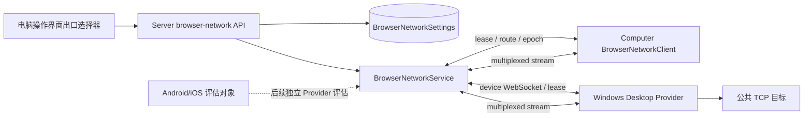

# 设计文档 - Windows 与移动端网络出口及电脑操作界面选择

状态：IN_PROGRESS

## 1. 概述

### 1.1 目标

- 在不修改 `BrowserNetworkClient` wire protocol 的前提下支持 Windows Desktop Provider。
- 在电脑操作界面直接暴露现有 ranked egress 的当前状态与手动选择入口。
- 保持服务端 `sourceOrder`、revision、lease、route epoch 和 fencing 为唯一权威状态。
- 将 Android/iOS 的网络出口能力限定为有证据的技术评估，不提前承诺移动端后台 Provider。

### 1.2 覆盖需求

- `requirements.md` 需求 1：Windows Desktop 网络出口提供者
- `requirements.md` 需求 2：电脑操作界面查看网络出口
- `requirements.md` 需求 3：电脑操作界面手动选择出口
- `requirements.md` 需求 4：Android 与 iOS 可行性评估

### 1.3 技术约束

- 后端：Bun、TypeScript、`BrowserNetworkService`
- Desktop：Electron 主进程、React renderer、Node `fetch`/WebSocket/`node:net`
- Computer：Linux Docker image、TUN、tun2socks、SOCKS gateway
- 数据存储：PostgreSQL `BrowserNetworkSettings`
- 认证授权：Desktop machine credential、connection ID、deployment ID、computer control token
- 外部依赖：Electron Builder Windows NSIS、Android/iOS 原生后台生命周期与网络 API

## 2. 架构

### 2.1 系统结构

用户手动选择只修改服务端已有的 `sourceOrder`。Computer 仍然接收服务端下发的 route，Desktop Provider 仍然只负责本地公共 TCP 出站。

### 2.2 模块职责

| 模块 | 职责 | 输入 | 输出 |
| --- | --- | --- | --- |
| `DesktopBrowserNetwork` | 管理 Desktop Provider 的平台能力、consent、identity、lease client | `platform`、enrollment connection、本地 consent | `NetworkSharingStatus`、provider WebSocket |
| `BrowserNetworkClient` | 维护 route lease、epoch、multiplexed streams 和 reconnect | WebSocket、route、目标 host/port | TCP `Duplex`、route 状态 |
| `BrowserNetworkService` | 验证 provider、保存顺序、选择活动来源、fence route | device/computer peer、数据库设置 | `BrowserNetworkView`、route grant |
| `BrowserNetworkSettings` | 展示全量来源并修改 `sourceOrder` | `BrowserNetworkView` | ranked update |
| `BrowserNetworkIndicator` | 在电脑操作界面显示当前出口并提供手动选择 | `BrowserNetworkView`、client API | ranked update、状态刷新 |
| Android/iOS 评估文档 | 记录移动端生命周期、权限和后台网络限制 | 当前协议、移动端工程能力 | 后续 Spec 边界与结论 |

### 2.3 关键流程

#### 2.3.1 Windows Provider 启动

1. Windows Desktop 完成现有 `DesktopMachineEnrollment`，获得 `credential` 和 `connectionId`。
2. `DesktopBrowserNetwork.configure()` 允许 `win32` 平台，查询 deployment identity。
3. `NetworkConsentStore` 按 server URL 与 deployment ID 读取本地 consent。
4. consent 开启后，创建 `BrowserNetworkClient`，角色为 `device`，发送 `outcomego-browser-network.v1` WebSocket。
5. Server 验证 machine credential、connection ID 和 lease，注册 Windows machine 为 eligible provider。
6. Server 根据 `sourceOrder` 选择活动来源，向 Computer 和 Windows Provider 下发同一 route epoch。

#### 2.3.2 手动选择出口

1. 电脑操作界面的出口控件读取 `GET /api/v0/server-settings/browser-network`。
2. 控件列出 `sourceOrder`，将 server 和可用 Desktop Provider 标记为可选。
3. 用户选择目标来源并确认连接会被中断。
4. 控件提交当前 `revision`、`mode: ranked`、以及把目标来源移动到第一位的 `sourceOrder`。
5. Server 校验 revision、来源存在和来源可用性，持久化顺序。
6. `BrowserNetworkService.update()` 调用现有 `reconcile(true, true)`，生成新 epoch、fence 旧 stream，并向 Computer/Provider 发送 invalidate/lease。
7. 控件刷新 view，只在新的 revision/epoch 返回后显示目标来源为 active。

#### 2.3.3 Windows Provider 断线

1. WebSocket 关闭、lease 过期、机器断连或网络 fingerprint 改变。
2. Desktop 停止旧 client，清理 provider 状态并按现有逻辑重试 identity/connection。
3. Server 将来源标记为不可用，按 `sourceOrder` 选择下一个 eligible 来源。
4. Computer 失去旧 route epoch 上的流，进入 applying/available 或 unavailable 状态。

#### 2.3.4 Android/iOS 评估边界

- Android：复用 server channel、machine credential 和 multiplexed TCP 协议在协议层可行；需要前台服务、持久 WebSocket、网络变化监听、应用级 consent 和公共 TCP dialer。后台 provider 需要显式 foreground notification，并需要验证系统省电策略。
- iOS：协议层可复用；前台运行时可实现 provider；持续后台 provider 需要 Network Extension 或其他系统授权，普通 App 生命周期无法保证长期 WebSocket 与 TCP 出站。移动端不在本次实现范围。

## 3. 组件和接口

### 3.1 核心组件

覆盖需求：1、2、3、4

- `DesktopBrowserNetwork.supported()`：加入 Windows 平台支持。
- `DesktopBrowserNetwork`：复用现有 enrollment、consent、lease 和 reconnect。
- `BrowserNetworkIndicator`：从纯状态标签扩展为状态与选择控件。
- `BrowserNetworkService.update()`：继续作为唯一的顺序修改和 route fence 入口。
- `BrowserNetworkView` / `NetworkSettingsUpdate`：不新增第二份 egress 数据结构。
- `docs/20261113-移动端网络出口可行性评估.md`：保存 Android/iOS 评估结论。

### 3.2 数据结构

#### 3.2.1 `BrowserNetworkView`

沿用 `packages/plugin-sdk/src/browser-network/protocol.ts` 中的结构：

| 字段 | 类型 | 必填 | 说明 | 约束 |
| --- | --- | --- | --- | --- |
| `settings.sourceOrder` | `string[]` | 是 | 出口优先级 | 包含 `server`，无重复 |
| `settings.revision` | `number` | 是 | 并发修改版本 | 提交时必须匹配 |
| `runtime.state` | union | 是 | 当前路由状态 | `server`、`ready`、`applying`、`waiting_for_device`、`unavailable`、`update_required` |
| `runtime.activeMachineId` | `string | null` | 是 | 当前活动 Desktop Provider | server 模式为 `null` |
| `devices[].working` | `boolean  undefined` | 否 | 来源当前是否可用 | 由 server lease 和设备状态决定 |

#### 3.2.2 `NetworkSettingsUpdate`

沿用现有结构：

| 字段 | 类型 | 必填 | 说明 | 约束 |
| --- | --- | --- | --- | --- |
| `expectedRevision` | `number` | 是 | 防止覆盖新顺序 | 必须等于服务端当前 revision |
| `mode` | `"ranked"` | 是 | 手动选择使用 ranked | 不新增临时模式 |
| `machineId` | `null` | 是 | ranked 不使用单一 machineId | 必须为 `null` |
| `sourceOrder` | `string[]` | 是 | 目标来源置于第一项的顺序 | 必须包含 `server` 且无重复 |

### 3.3 接口契约

覆盖需求：1、2、3

#### 3.3.1 读取网络出口状态

- 类型：HTTP
- 路径或标识：`GET /api/v0/server-settings/browser-network`
- 输入：已登录客户端请求
- 输出：`BrowserNetworkView`
- 校验：现有服务端授权和设备状态计算
- 错误：沿用现有 API 错误格式

#### 3.3.2 手动选择网络出口

- 类型：HTTP
- 路径或标识：`PATCH /api/v0/server-settings/browser-network`
- 输入：`NetworkSettingsUpdate`
- 输出：更新后的 `BrowserNetworkView`
- 校验：revision、来源、sourceOrder、Computer peer 和 Desktop peer 可用性
- 错误：revision 冲突、来源不可用、请求结构错误

#### 3.3.3 Windows Provider channel

- 类型：WebSocket
- 路径或标识：`/api/v0/machines/channel/browser-network`
- 输入：machine credential、machine ID、connection ID、`outcomego-browser-network.v1` frame
- 输出：lease、route、multiplexed stream frame
- 校验：machine authentication、deployment ID、lease、route epoch、public-only dial
- 错误：provider drop、route invalidate、stream reset

## 4. 数据与状态模型

### 4.1 数据关系

`BrowserNetworkSettings.sourceOrder` 保存来源的稳定优先级。Desktop Provider 的在线状态不写入 `sourceOrder`，而由当前 machine connection、lease 和 route epoch 计算。Windows 与 macOS/Linux 使用同一 provider 模型。

移动端不加入当前 `sourceOrder`，直到完成独立的原生生命周期、后台保活和公共 TCP 出站验证。

### 4.2 状态流转

| 状态 | 含义 | 进入条件 | 退出条件 |
| --- | --- | --- | --- |
| `server` | 当前使用 Server connection | server 是活动来源且 Computer route 已应用 | ranked 选择可用 Desktop 并完成 epoch 切换 |
| `ready` | 当前使用 Desktop Provider | Computer 和 Provider 都持有同一有效 epoch | provider 断线、lease 过期或手动切换 |
| `applying` | 正在切换出口 | sourceOrder/revision 改变或 peer ACK 尚未完成 | 新 route 应用或失败 |
| `waiting_for_device` | 等待指定 Desktop Provider | sourceOrder 第一项为不可用 device | provider 上线或改选其他来源 |
| `unavailable` | 没有可用出口 | Computer peer 或活动来源不可用 | lease 恢复或重试成功 |
| `update_required` | Computer runtime 不支持当前协议 | Computer peer 未连接 | Computer 更新并重新连接 |

## 5. 错误处理

### 5.1 错误类型

- `network_unsupported_platform`：Desktop 平台不支持 Provider；Windows 实现完成后不应再产生。
- `network_consent_required`：用户尚未允许该 server/deployment 使用本地网络。
- `network_device_unavailable`：手动选择的来源没有有效 machine connection 或 lease。
- `network_revision_conflict`：手动选择提交基于旧 revision。
- `network_egress_changed`：诊断结果完成时 route epoch 已变化。
- `network_destination_blocked`：目标为私有、local、非单播或其他策略拒绝目标。

### 5.2 错误响应格式

沿用现有 `ApiError` 和客户端错误映射。手动选择界面必须显示用户可理解的错误，不泄露 credential、内部 token 或网络地址以外的敏感信息。

### 5.3 处理策略

1. 输入验证错误：服务端拒绝并返回 400，客户端刷新状态。
2. revision 冲突：服务端返回 409，客户端丢弃本地草稿并重新加载 sourceOrder。
3. Provider 断线：服务端按 ranked order failover；Computer 进入过渡状态。
4. Desktop 网络变化：停止旧 client，重新 identity/lease；未重新取得有效 lease 前不声明 providing。
5. 目标策略错误：拒绝单个连接，不修改当前出口顺序。
6. 手动切换：确认后执行，现有连接可被 fence，不自动重放请求。

## 6. 正确性属性

### 6.1 属性 1：Provider 平台一致性

*对于任何* 支持的 Desktop 平台，System 都应该使用同一个 `BrowserNetworkClient` wire protocol、machine credential、deployment identity、lease 和 public-only dial 规则。

**验证需求：** `requirements.md` 需求 1

### 6.2 属性 2：手动选择唯一权威

*对于任何* 手动选择结果，System 都应该只持久化一份 `sourceOrder`，Computer 的活动 route 必须由 Server `BrowserNetworkService` 根据该顺序和有效 lease 计算。

**验证需求：** `requirements.md` 需求 3

### 6.3 属性 3：旧 route 不可继续使用

*对于任何* sourceOrder 变化、Provider 失效或 route epoch 变化，旧 epoch 上尚未完成的 stream 都应该被 fence 或 reset，不能继续把数据发送到旧出口。

**验证需求：** `requirements.md` 需求 1、需求 3

### 6.4 属性 4：移动端能力不被误报

*对于任何* Android 或 iOS 客户端，除非完成原生 provider、后台生命周期和公共 TCP 验证，否则 UI 和协议状态都不应该把它列为可用 Desktop Provider。

**验证需求：** `requirements.md` 需求 4

## 7. 测试策略

### 7.1 单元测试

- `DesktopBrowserNetwork` 在 `win32` 下支持 identity、consent、connect、stop 和 status。
- Windows 断线、睡眠、网络 fingerprint 变化、deployment identity 变化和 revoke 不复用旧 provider。
- `BrowserNetworkClient` 的 Windows provider 配置仍使用 `role: device` 和 public-only dial。
- 手动选择器将目标来源移动到第一项，保留其他来源顺序和 server fallback。
- revision 冲突、不可用来源、当前活动来源和 applying 状态显示正确。

### 7.2 集成测试

- Server BrowserNetworkService 与两个 Desktop Provider、一个 Computer peer 的 lease/failover/fencing。
- 手动选择更新与 Server 设置读取的一致性。
- Windows provider 使用真实 WebSocket、公共 TCP 目标和 DNS 的回放。
- Windows 睡眠/恢复、网络切换、退出应用和重新 enrollment 的回放。

### 7.3 端到端测试

- Windows runner 打包 Desktop，连接测试 Server，开启网络共享，验证 Computer 的出口 IP 与来源一致。
- Windows Provider 断线后验证 failover；恢复后验证现有 30 秒 failback 规则。
- 在 bot computer 的 VNC 操作界面中手动选择来源，验证 route 状态、出口诊断和现有网络连接中断提示。
- Android/iOS 仅执行静态能力审计和文档验收，不执行 Provider 端到端验收。

### 7.4 验证映射

| 需求 | 设计章节 | 验证方式 |
| --- | --- | --- |
| `requirements.md` 需求 1 | `design.md` §2.3.1、§2.3.3、§3.3.3、§6.1 | Windows unit/integration/e2e、server relay test |
| `requirements.md` 需求 2 | `design.md` §2.3.2、§3.2.1 | renderer component test、VNC manual check |
| `requirements.md` 需求 3 | `design.md` §2.3.2、§3.3.2、§6.2、§6.3 | server revision/fencing test、UI interaction test |
| `requirements.md` 需求 4 | `design.md` §2.3.4、§6.4 | dated feasibility document review |

## 8. 风险与待确认项

### 8.1 风险

- Windows VPN、企业代理或安全软件可能改变 Node DNS/TCP 的实际出口，需要真实 Windows runner 验证。
- 手动选择会 fence 现有连接；操作界面必须在确认前明确提示，避免用户误以为请求会自动恢复。
- Android 后台服务和 iOS Network Extension 需要原生权限、生命周期和发布策略，不能直接套用 Desktop 主进程实现。
- 电脑操作界面和 Server 设置同时修改 sourceOrder 时存在 revision 冲突，需要保留现有 409 刷新行为。

### 8.2 待确认项

- 手动选择是否需要只影响当前会话而不持久化优先级；本 Spec 采用持久化 ranked order，以复用现有数据模型。
- Android Provider 第一阶段是否接受“用户明确打开页面并保持前台/前台服务”的限制。
- iOS 是否接受“仅前台可用”还是需要申请 Network Extension 后再进入实现。
