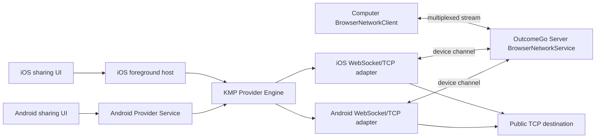

# 设计文档 - Android 与 iOS 网络出口提供者实现

状态：IN_PROGRESS

## 1. 概述

### 1.1 目标

- 在 `mobile/shared` 中实现 Android 和 iOS 共用的 browser-network Provider Engine。
- 复用现有 `outcomego-browser-network.v1` 协议、machine enrollment、deployment identity、lease、route epoch、stream window 和 public-only policy。
- Android 以用户主动启动的 Foreground Service 支持前台共享。
- iOS 以 active scene 前台共享作为第一阶段产品形态。
- 让服务端继续作为 route、sourceOrder 和 failover 的唯一权威。

### 1.2 覆盖需求

- `requirements.md` 需求 1：共享 Provider Engine
- `requirements.md` 需求 2：移动端 enrollment、consent 和 device channel
- `requirements.md` 需求 3：公共 TCP 网络出口
- `requirements.md` 需求 4：Android 前台 Provider
- `requirements.md` 需求 5：iOS 前台 Provider

### 1.3 技术约束

- 共享层：Kotlin Multiplatform、Kotlin serialization、Kotlin coroutines。
- Android：Kotlin、OkHttp WebSocket、`java.net.Socket` 或等价 TCP API、`ConnectivityManager.NetworkCallback`、Foreground Service、Keystore/加密存储。
- iOS：Kotlin/Native framework、Swift app host、Network.framework 或 URLSession WebSocket、`NWConnection`/等价 TCP API、`NWPathMonitor`、Keychain。
- 服务端：复用 `MachineService`、`BrowserNetworkService` 和现有 WebSocket relay。
- 认证授权：用户 session bearer token 用于 enrollment；machine credential 与 connection ID 用于 device channel。
- 数据存储：服务端现有 `HostMachine`、`BrowserNetworkSettings`；移动端本地保存安装身份、credential 和按 server/deployment 的 consent。
- 约束：不引入 TUN、UDP、ICMP、局域网访问或新的 route 选择模型。

## 2. 架构

### 2.1 系统结构



移动端只负责 `device` peer。Server 根据有效 lease 和 `sourceOrder` 选择活动来源；Computer 继续作为另一端连接。移动端不创建本地监听端口，也不改变 Computer 的 proxy 或 route 选择逻辑。

### 2.2 模块职责

| 模块 | 职责 | 输入 | 输出 |
| --- | --- | --- | --- |
| `mobile/shared` Provider Engine | frame、control、lease、route、mux、重连和错误状态机 | 平台 transport、clock、storage、network events | provider state、socket stream 操作 |
| `MobileEnrollment` | 调用 enrollment、connect 和 identity API | server、session token、machine ID、label | credential、connection ID、deployment ID |
| `MobileConsentStore` | 保存 server/deployment scoped consent | server、deployment、enabled | 是否允许共享 |
| `MobileWebSocketTransport` | 提供二进制 WebSocket 收发 | URL、headers、protocol | binary frames、close/error |
| `MobileTcpDialer` | DNS、public-only 校验和 TCP 建立 | host、port、AbortSignal | readable/writable socket |
| `AndroidProviderService` | 持有 Android provider 生命周期 | UI intent、session、network callbacks | service state、notification |
| `IosProviderHost` | 绑定 iOS active scene 生命周期 | Swift lifecycle、KMP engine | provider state、UI status |
| `BrowserNetworkService` | 服务端认证、路由选择、epoch fence | device/computer peer、lease | route、stream relay |

### 2.3 关键流程

#### 2.3.1 启动和 enrollment

1. 用户在移动端确认当前 server 的网络共享。
2. 平台宿主读取当前 session；没有有效 session 时拒绝启动。
3. `MobileEnrollment` 从加密存储读取或生成 UUID machine ID，并发送 `POST /api/v0/machines/enroll`。
4. 服务端返回 machine credential；移动端立即调用 `/api/v0/machines/channel/connect` 获取 connection ID。
5. 移动端调用 `/api/v0/machines/channel/browser-network-identity` 获取 deployment ID。
6. `MobileConsentStore` 按规范化 server URL 和 deployment ID 检查授权。
7. 授权有效时建立 `wss` device channel，并发送首个 lease challenge。
8. 服务端验证 machine credential、connection ID、deployment ID 和 protocol，随后按现有 ranked 逻辑注册 provider。

#### 2.3.2 lease 和 route 应用

1. Engine 连接后发送 control `lease`，携带 nonce、deploymentId 和 `maxWindow`。
2. 服务端返回 route，包括 mode、machineId、revision、epoch、available 和 streamWindow。
3. Engine 校验 route、deployment ID、epoch 和协商窗口，然后发送 control `applied`。
4. Engine 以 2 秒目标周期 renewal，并以服务端返回时间为 lease 有效期边界。
5. 收到 `invalidate` 或新的 epoch 时，Engine 立即 fence 所有旧 stream，并重新 challenge。
6. lease 过期前未收到有效续租时，Engine 将 provider 标记为 unavailable，停止新的 `Open`。

#### 2.3.3 multiplexed TCP stream

1. 服务端向 device peer 发送 `Open(id, {host, port, epoch})`。
2. Engine 验证 epoch、目标结构和当前 provider 状态。
3. `MobileTcpDialer` 规范化 hostname，执行 DNS 查询，拒绝任意解析结果中的非公共地址。
4. TCP 建立后发送 `Ready`，并启动 socket 与 mux stream 的双向泵送。
5. socket 读取数据时发送 `Data`，收到 `Window` 时恢复发送 credit。
6. socket 或 peer half-close 时发送 `Fin`；发生取消、epoch 变化或异常时发送 `Reset` 并销毁 socket。
7. 迟到的 DNS 或 TCP 结果必须检查 AbortSignal 和 epoch；不匹配时立即关闭。

#### 2.3.4 Android 前台生命周期

1. 前台 UI 请求启动 Provider Service。
2. Service 创建 provider notification、启动 engine、注册 `NetworkCallback`，并在网络可用时执行 enrollment/channel。
3. Service 不依赖 Activity；UI 通过状态流读取 provider 状态。
4. 网络 callback 报告能力变化时，Service 取消旧 transport、fence streams，并按 backoff 重连。
5. Stop Sharing、logout、revoke 或 service destroy 时，Service 执行幂等 close，取消 coroutine、关闭 sockets、注销 callback、释放 wake lock 并移除通知。

#### 2.3.5 iOS 前台生命周期

1. active scene 中的 UI 请求启动 Provider Host。
2. Host 创建 engine、读取 Keychain/consent，并注册 `NWPathMonitor`。
3. scene 进入 inactive/background 时，Host 停止续租并关闭 provider channel；状态变为 unavailable。
4. scene 回到 active 时，Host 根据 consent 和 session 重新 enrollment/reconnect。
5. `NWPathMonitor` 报告路径变化时，Host 取消旧 WebSocket、TCP dial 和 stream，并重新建立新路径上的 channel。
6. 第一阶段不使用 Network Extension；后台持久 provider 另行立项。

## 3. 组件和接口

### 3.1 核心组件

覆盖需求：1、2、3、4、5

- `NetworkFrameCodec`：按现有 12-byte header 和 payload 限制编码/解码 frame。
- `NetworkMux`：维护 stream map、stream ID、窗口 credit、FIN/RESET 和队列预算。
- `ProviderSession`：维护 WebSocket、lease challenge、route、epoch、重连和 provider state。
- `MobileEnrollment`：实现 enrollment、connection ID 和 deployment identity 获取。
- `PublicTargetPolicy`：实现 hostname、DNS 和 IP 公共地址校验。
- `AndroidProviderService`：托管 Android 前台服务和通知。
- `IosProviderHost`：托管 iOS active scene provider 生命周期。

### 3.2 数据结构

覆盖需求：1、2、4、5

#### 3.2.1 `ProviderConfiguration`

| 字段 | 类型 | 必填 | 说明 | 约束 |
| --- | --- | --- | --- | --- |
| `serverUrl` | `String` | 是 | 连接的 server origin | 只允许 HTTP/HTTPS origin；WebSocket 时转换为 ws/wss |
| `sessionToken` | `String` | 是 | 当前用户 session token | 不写日志；只用于 enrollment |
| `machineId` | `String` | 是 | 安装级机器身份 | UUID；跨重启稳定 |
| `label` | `String` | 是 | 移动设备显示名 | 非空，最多 200 字符 |
| `consentEnabled` | `Boolean` | 是 | 当前部署共享同意 | 只能由用户操作改变 |

#### 3.2.2 `ProviderSnapshot`

| 字段 | 类型 | 必填 | 说明 | 约束 |
| --- | --- | --- | --- | --- |
| `state` | `ProviderState` | 是 | provider 生命周期状态 | stopped、enrolling、connecting、ready、reconnecting、unavailable、revoked、failed |
| `machineId` | `String?` | 否 | 当前安装身份 | credential 失效时仍可保留 |
| `deploymentId` | `String?` | 否 | 当前部署身份 | 只接受 UUID |
| `routeEpoch` | `String?` | 否 | 当前已应用 route | epoch 变化时旧 stream 必须销毁 |
| `activeStreams` | `Int` | 是 | 当前 mux stream 数量 | 0 至 64 |
| `lastErrorCode` | `String?` | 否 | 安全错误码 | 不包含 token、IP 列表或完整异常 |

#### 3.2.3 `OpenTarget`

| 字段 | 类型 | 必填 | 说明 | 约束 |
| --- | --- | --- | --- | --- |
| `host` | `String` | 是 | 目标 hostname 或 IP | 最长 253；拒绝空白、URL 字符和 zone id |
| `port` | `Int` | 是 | 目标 TCP 端口 | 1 至 65535 |
| `epoch` | `String` | 是 | 服务端 route epoch | 必须等于当前 provider epoch |

### 3.3 接口契约

覆盖需求：2、3、4、5

#### 3.3.1 machine enrollment

- 类型：HTTP
- 路径或标识：`POST /api/v0/machines/enroll`
- 输入：用户 session bearer、`{ machineId, label }`
- 输出：`{ machineId, credential }`
- 校验：服务端要求有效 session、UUID machine ID、非空 label；已有 disabled machine 不能重新 enrollment。
- 错误：401 session 无效、403 machine disabled、400 identity invalid。

#### 3.3.2 machine connection

- 类型：HTTP
- 路径或标识：`POST /api/v0/machines/channel/connect`
- 输入：machine credential、`x-outcomego-machine-id`
- 输出：`{ connectionId }`
- 校验：credential hash、machine enabled、relay transport、auth session 有效。
- 错误：401 machine unauthorized、连接创建失败。

#### 3.3.3 deployment identity

- 类型：HTTP
- 路径或标识：`GET /api/v0/machines/channel/browser-network-identity`
- 输入：machine credential、machine ID、connection ID
- 输出：`{ deploymentId }`
- 校验：必须通过 machine authentication。
- 错误：401 machine unauthorized、invalid deployment identity。

#### 3.3.4 device channel

- 类型：WebSocket
- 路径或标识：`/api/v0/machines/channel/browser-network`
- 输入：`Sec-WebSocket-Protocol: outcomego-browser-network.v1`、machine credential、machine ID、connection ID、binary frame。
- 输出：lease、invalidate、route 和 multiplexed stream frame。
- 校验：不接受 `Origin`；验证 machine credential、connection ID、deployment ID、control sequence、route epoch 和 stream window。
- 错误：network unauthorized、machine unauthorized、device unavailable、destination blocked、dns failed、connect failed、capacity exceeded。

#### 3.3.5 Platform adapter

- 类型：Kotlin interface / platform implementation
- 路径或标识：`ProviderPlatformAdapter`
- 输入：WebSocket URL、headers、目标 host/port、取消信号、网络变化。
- 输出：binary WebSocket transport、TCP byte stream、provider lifecycle events。
- 校验：adapter 不得修改 shared engine 的 route 或 stream 状态；所有 socket 都必须可取消、可关闭。
- 错误：平台网络不可用、socket closed、permission/restriction、transport failure。

## 4. 数据与状态模型

### 4.1 数据关系

- `Session` 由现有移动端登录流程保存；它只用于向服务端 enrollment。
- `machineId` 是安装级稳定身份，不随普通进程重启变化。
- `credential` 是服务端为 machineId 生成的秘密，保存在平台安全存储中；重新 enrollment 会替换旧 credential。
- `deploymentId` 由服务端 browser-network settings 提供，不由客户端生成。
- consent key 为规范化 server origin 与 deploymentId 的组合；同一安装可对多个 server/deployment 独立授权。
- `ProviderSession` 只保存内存中的 WebSocket、route、epoch、pending challenge 和 stream；关闭后必须清空连接状态。

### 4.2 状态流转

| 状态 | 含义 | 进入条件 | 退出条件 |
| --- | --- | --- | --- |
| `stopped` | 用户未开启或服务已停止 | 初始、用户停止、logout | 用户明确开启 |
| `enrolling` | 正在获取 credential/connection/deployment | session 有效且 consent flow 开始 | enrollment 成功或失败 |
| `connecting` | 正在建立 device WebSocket | enrollment 和 consent 成功 | lease ready、失败或取消 |
| `ready` | channel 有效且 route lease 可续租 | 收到有效 route 并发送 applied | epoch 变化、lease 过期、网络变化、停止 |
| `reconnecting` | 按 bounded backoff 重建 channel | WebSocket/TCP 网络失败且仍允许共享 | ready、停止、credential revoked |
| `unavailable` | 当前不能安全提供出口 | Doze、后台、无网络、lease 过期或平台限制 | 用户恢复前台/网络并重新连接 |
| `revoked` | credential、session 或 consent 已撤销 | 服务端 401、用户撤销或 logout | 用户重新登录并重新授权 |
| `failed` | 需要用户处理的配置/平台错误 | 非重试 enrollment 或 adapter 错误 | 用户重试或停止 |

## 5. 错误处理

### 5.1 错误类型

- `machine_enrollment_required`：没有有效 session 或 machine credential。
- `machine_unauthorized`：credential、machine enabled 状态或 auth session 无效。
- `network_consent_required`：用户未允许当前 server/deployment 共享。
- `network_protocol_invalid`：frame、control sequence、window 或 route 不合法。
- `network_epoch_stale`：消息或 socket 属于旧 route epoch。
- `destination_blocked`：目标不是允许的公共单播地址。
- `dns_failed`：DNS 查询失败、超时或返回结果不可用。
- `connect_timeout`：TCP 连接超过单次尝试限制。
- `connect_failed`：所有已验证地址均连接失败。
- `network_unavailable`：平台网络不存在、进入后台限制或 lease 已过期。
- `provider_capacity_exceeded`：超过 64 条 stream 或队列预算。

### 5.2 错误响应格式

Provider Engine 内部使用安全错误对象：

```json
{
  "code": "destination_blocked",
  "retryable": false,
  "message": "The destination is not allowed"
}
```

WebSocket control `Error`/`Reset` frame 只发送 `code`，不发送 credential、session token、完整 DNS 地址列表或平台异常堆栈。

### 5.3 处理策略

1. 输入验证错误：关闭当前 stream；发现 frame 结构违反协议时关闭 channel。
2. enrollment 401/403：停止自动重试，清理 credential，提示用户重新登录或重新启用设备。
3. consent 关闭：立即停止 channel，不执行后台重新授权。
4. DNS/TCP 目标失败：只结束当前 stream，不影响 provider lease 和其他 stream。
5. 网络变化：取消旧 transport，fence epoch 相关 stream，按 bounded backoff 重连。
6. lease 过期：进入 unavailable；服务端按 ranked source 选择其他来源。
7. 平台后台限制：报告 unavailable，不伪造 lease，不使用 WorkManager 或普通后台任务维持长连接。
8. 清理失败：继续执行其余 close/release 操作，并记录有限错误码；所有 close API 必须幂等。

## 6. 正确性属性

### 6.1 属性 1：跨平台协议一致性

*对于任何* Android 或 iOS Provider Engine 输入，frame header、control sequence、lease challenge、route application、stream window 和 teardown 结果都应该与现有 browser-network wire contract 一致。

**验证需求：** `requirements.md` 需求 1

### 6.2 属性 2：旧 epoch 不可复用

*对于任何* route epoch 变化、provider 停止、网络切换或 WebSocket 重连，旧 epoch 上的 stream、pending dial 和迟到 socket 都不得继续传输数据。

**验证需求：** `requirements.md` 需求 1、需求 3、需求 4、需求 5

### 6.3 属性 3：移动端不能扩大服务端权限

*对于任何* 移动端收到的 Open target，Provider 只能连接经过公共地址策略校验的 TCP 目标，不得因为平台 socket API 或 DNS 行为而访问私有、局域网或特殊用途地址。

**验证需求：** `requirements.md` 需求 3

### 6.4 属性 4：用户授权是 provider 前置条件

*对于任何* server/deployment 组合，未完成当前用户 consent 时，移动端不得建立或续租 device channel；撤销 consent 后所有新旧 stream 都必须停止。

**验证需求：** `requirements.md` 需求 2

### 6.5 属性 5：平台生命周期不会伪造可用状态

*对于任何* Android service 被停止、iOS scene 进入 background、网络不可用、Doze/平台限制或 lease 过期的情况，ProviderSnapshot 都不得保持 `ready`。

**验证需求：** `requirements.md` 需求 4、需求 5

## 7. 测试策略

### 7.1 单元测试

- KMP frame encode/decode：版本、header、type、id、payload、窗口长度和非法输入。
- KMP JSON control：lease、invalidate、route、applied、错误码和 sequence。
- KMP mux：64 stream 上限、窗口 credit、半关闭、RESET、取消、队列预算和迟到 dial。
- KMP ProviderSession：lease renewal、过期、epoch fencing、backoff、credential revoke。
- KMP PublicTargetPolicy：hostname、IPv4/IPv6、DNS 混合结果、私有/特殊/transition 地址和取消。
- enrollment：machine ID、credential、connection ID、deployment ID 和重新 enrollment。
- consent：server/deployment 隔离、撤销写入顺序和清理。

### 7.2 集成测试

- Android adapter 使用 fake WebSocket/TCP transport 完成 shared engine round-trip。
- iOS adapter 使用 fake WebSocket/TCP transport 完成 shared engine round-trip。
- Android ConnectivityManager callback 触发 channel fence 和 reconnect。
- iOS NWPathMonitor callback 触发 channel fence 和 reconnect。
- Android service stop、notification action、logout、revoke 和 `onDestroy` 清理。
- iOS scene active/inactive/background/active 状态与 provider snapshot 一致。
- Server BrowserNetworkService 与 Android/iOS fake device peer 完成 lease、Open、Data、Window、Fin、Reset 和 failover。

### 7.3 端到端测试

- Android 真机：enrollment、用户 consent、常驻通知、公共 HTTPS/TCP 目标、Wi-Fi 断开/恢复、移动网络切换、屏幕关闭和服务停止。
- Android 真机：私有地址、localhost、metadata 地址、DNS 混合私有结果和取消连接均被拒绝。
- iOS 真机或模拟器：active scene 前台 enrollment、公共 TCP、网络路径变化、进入 background 后 lease 停止、回到 active 后重新连接。
- Android/iOS：服务端 egress 检查返回的 sourceId/epoch 与当前移动设备一致。
- Android/iOS：route epoch 切换期间旧 TCP 连接被关闭，未发生请求重放。
- Android API 34 与 API 35+ 分别验证前台服务类型、通知、Doze/省电和系统限制；iOS 后台持续 provider 不作为本 Spec 验收项。

### 7.4 验证映射

| 需求 | 设计章节 | 验证方式 |
| --- | --- | --- |
| `requirements.md` 需求 1 | `design.md` §2.2、§3.1、§4.2、§6.1、§7.1 | KMP common tests、Android/iOS adapter contract tests |
| `requirements.md` 需求 2 | `design.md` §2.3.1、§3.3.1 至 §3.3.4、§4.1、§6.4 | enrollment/consent unit、server integration、device login flow |
| `requirements.md` 需求 3 | `design.md` §2.3.3、§3.2.3、§5.1、§6.2、§6.3 | policy/mux tests、public TCP device test、blocked destination test |
| `requirements.md` 需求 4 | `design.md` §2.3.4、§3.1、§4.2、§6.5、§7.2、§7.3 | Android service tests、ADB device run、API 34/API 35+ matrix |
| `requirements.md` 需求 5 | `design.md` §2.3.5、§3.1、§4.2、§6.5、§7.2、§7.3 | iOS lifecycle tests、Network path test、foreground device run |

## 8. 风险与待确认项

### 8.1 风险

- Kotlin/Native 与 Swift 工程的 framework 集成、协程取消和 binary `ByteArray` 边界需要真实 iOS 构建验证。
- Android Foreground Service type、Android 15 运行限制、通知权限和厂商省电策略可能限制 provider 的持续时间。
- iOS active scene 进入 background 后无法维持长期 lease；前台验收结果不能外推为后台能力。
- iOS Network.framework、URLSession WebSocket 和 Kotlin/Native callback 的线程/actor 边界可能影响 socket 回调实现。
- 公共地址策略在 Android/iOS DNS API 上可能返回不同地址顺序，需要统一验证所有结果而不是只验证首个地址。
- 移动网络、VPN、IPv6-only、NAT64 和 captive portal 可能影响真实 TCP 出口结果。

### 8.2 待确认项

- Android Provider Service 第一阶段采用 `dataSync` 还是需要进一步评估 `specialUse`；该选择必须结合 Android 15 限制和发布政策确认。
- iOS 第一阶段是否只支持 active scene，还是需要在实验阶段加入短时后台恢复测试；不得在未确认前承诺长期后台。
- 移动端 provider 是否默认加入服务端 `sourceOrder`，或先由设置页面明确启用后才加入 ranked pool；建议沿用服务端现有首次 lease 自动加入规则，但 UI 必须明确展示。
- iOS 是否需要后续单独 Spec 评估 Network Extension/App Proxy；本 Spec 不实现该能力。
